--- 
id: file-sources-f1-f4 
title: "File-Based Data Sources: F1 (Historical Demand) & F4 (Traditional Agencies)" 
sidebar_label: "F1 & F4: File Sources (CSV)" 
sidebar_position: 2 
description: "Comprehensive technical specification, architectural role, shared catalog (v1.1.0) alignment, data profiling, IQR outlier mathematics, defect injection contracts, and batch consumption strategy for HospedaPlus Revenue sources F1 and F4." 
tags: \[data-sources, f1, f4, batch-layer, medallion-bronze, data-quality, spark, airflow, catalog\]
---
# File-Based Data Sources: F1 (Historical Demand) & F4 (Traditional Agencies)

| Attribute | Specification | 
| ----- | ----- | 
| **Canonical Repository** | `buenavista-csv` | 
| **Domain Owner** | Oscar Corzo (Data Engineering — File Sources Domain) | 
| **Shared Reference Contract** | `schemas/catalog.json` (**Catalog Version `1.1.0`** — synchronized across `F1`–`F7`) | 
| **Covered Sources** | **F1** (`hotel_bookings.csv` — Kaggle Historical CSV) and **F4** (`*_week.csv` — Simulated Traditional Agency Files) | 
| **Architectural Layer** | **Batch Layer** (Daily / Weekly Scheduled Ingestion → Amazon S3 `Bronze` → PySpark `Silver` & `Gold`) | 
| **Related User Stories** | `US-11` (F1 Exploration & IQR Audit), `US-14` (Defects Catalog), `US-24` (F2 Event Coupling), `US-25` (F4 Generator), `US-26` (Configurable Defect Injection), `US-5` (Repo Separation), `US-6` (Quality Controls & Batch Readiness) | 
| **Business Rules Supported** | `RN-01` (Occupancy, Net ADR, Net RevPAR), `RN-02` (Channel Commissions), `RN-03` (90-Day Cancellation Baseline for Overbooking), `RN-05` (Season & 14-Day YoY Pickup Multipliers), `RN-06` (Event Multiplier `1.15x`), `RN-08` (Cross-Channel Deduplication ±1 Day), `RN-11` (Guest PII Pseudonymization) | 
| **Runtime Status** | `Done` — Audited, Catalog-Aligned (`v1.1.0`), Deterministically Seeded, and Batch-Ready | 

:::info Repository Boundary & Shared Catalog Contract (US-5, US-6 & Catalog v1.1.0) Per the team's domain separation architecture, `buenavista-csv` exclusively houses standalone CSV/Excel data sources (**F1** and **F4**), their canonical JSON schemas, deterministic file generators, and non-destructive data-quality validators. It operates with **zero runtime coupling** to the FastAPI guest reviews service (**F5**, `buenavista-api`), the RabbitMQ streaming broker (**F2**, `buenavista-streaming`), or the operational PostgreSQL database (**F3**, `buenavista-simulated-db`), while enforcing 100% referential parity through the shared `schemas/catalog.json` (`v1.1.0`) specification. :::

## 1. Architectural Role and Cross-Source Standardization (`catalog.json` v1.1.0)

HospedaPlus Revenue implements a hybrid **Lambda + Medallion Architecture** on AWS (`us-east-2`) to reconcile two competing operational demands: sub-250 ms real-time inventory protection (`RNF-01`, `RNF-02`) and deep historical recalculation of dynamic rates and overbooking ceilings before **06:00 local hotel time** (`RNF-03`).

Within this topology, **F1** and **F4** serve as the foundational file-based inputs of the **Batch Layer**, governed by the platform-wide reference catalog (`schemas/catalog.json`, `v1.1.0`):

| Catalog Dimension | Standardized Specification (`catalog_version: 1.1.0`) | Impact on `buenavista-csv` (`F1` & `F4`) | 
| ----- | ----- | ----- | 
| **Countries & Hotel Currencies** | `CO` (`COP`), `MX` (`MXN`), `BR` (`BRL`), `PT` (`EUR`), `ES` (`EUR`) | Defines each hotel's native billing currency (`hotels[].currency`) and local timezone (`America/Bogota`, `Europe/Lisbon`, etc.). | 
| **Agency & Reporting Currencies** | `USD` (*"accepted from agencies (F4); not a hotel currency"*); `reporting_currency = "COP"` | `F4` agency rows bill in either the hotel's native currency (`COP`, `MXN`, `BRL`, `EUR`) or `USD`. All metrics convert to `COP` in Silver/Gold via `F7`. | 
| **28 Standardized Hotels** | `HP-PT-001`..`003` (3), `HP-CO-001`..`010` (10), `HP-MX-001`..`006` (6), `HP-BR-001`..`006` (6), `HP-ES-001`..`003` (3) — **4,000 rooms total** | Replaces legacy `hotel-001` IDs. Explicitly maps F1's `"City Hotel"` → **`HP-PT-001`** (207 rooms) and `"Resort Hotel"` → **`HP-PT-002`** (171 rooms). | 
| **Room Types** | `SINGLE` (max 1), `DOUBLE` (max 2), `TWIN` (max 2), `SUITE` (max 4) | Enforced across all `F4` agency exports (`room_type` / `room_category`) and validated by `buenavista_csv.validator`. | 
| **Channels & Commissions (`RN-02`)** | **F3 Direct/Corp (`0%`)**: `direct_web`, `corporate` | **F2 OTA (`18%`)**: `booking_channel_a`, `booking_channel_b`, `expedia`, `direct_ota` | **F4 Agencies (`10%`)**: `AG01`..`AG15` | Maps all 15 traditional agencies to canonical channel codes `AG01` (`ViajaFacil`) through `AG15` (`Viajes Amanecer`) with `commission_pct = 10` (`0.10`). | 
| **Country Seasons & Pricing (`RN-05`, `RN-06`)** | Per-country `MM-DD` ranges for `HIGH` (`1.25x`), `MID` (`1.00x`), and `LOW` (`0.85x`); `event_multiplier = 1.15x`; `pickup` (`14d` window, `±15%` threshold → `1.10x` / `0.92x`) | Used by `buenavista_csv.f1_audit` to classify F1 historical bookings into Portugal (`PT`) seasonal buckets and by Spark Silver/Gold for dynamic pricing. | 

### End-to-End Data Flow across the Medallion Architecture

```mermaid
flowchart TD
    A["1. Sources & Shared Catalog<br/>(buenavista-csv — Catalog v1.1.0)<br/><br/>• F1: data/f1_historical/hotel_bookings.csv<br/>119,390 rows → mapped to HP-PT-001 & HP-PT-002<br/><br/>• F4: output/f4_agency_files/*_week.csv<br/>15 weekly agency CSVs, AG01..AG15, Layouts A & B<br/><br/>• Contract: schemas/catalog.json<br/>28 HP-XX-NNN hotels, 4,000 rooms, 5 currencies, RN-05 rules"]

    B["2. Batch Orchestration & Quality Gate<br/>(VPC Private Subnet - EC2 t3.large + Celery)<br/><br/>• Apache Airflow Scheduler dispatches tasks via RabbitMQ<br/>(vhost: 'airflow') to Celery Workers<br/><br/>• Pre-ingestion Quality Gate (buenavista_csv.validator)<br/>validates F1 & F4 against catalog.json v1.1.0,<br/>emitting quality_validation_report.json non-destructively (US-6)"]

    C["3. Data Lake Landing — Amazon S3 Bronze<br/>(Raw Immutable Zone)<br/><br/>• s3://hospedaplus-datalake-bronze/f1_historical/<br/>load_date=YYYY-MM-DD/hotel_bookings.csv<br/><br/>• s3://hospedaplus-datalake-bronze/f4_agencies/<br/>year=YYYY/week=WW/&lt;agency_slug&gt;_week.csv<br/><br/>• Cost Optimization: S3 Lifecycle rule transitions<br/>Bronze objects to Standard-IA after 30 days"]

    D["4. Distributed Processing — Apache Spark on AWS ECS Fargate Spot<br/>(Bronze → Silver → Gold)<br/><br/><b>Bronze → Silver (Cleaned & Conformed Parquet):</b><br/>- Enforces explicit PySpark StructType schemas (Topic 13 — no schema inference)<br/>- Maps F1 'City Hotel' → HP-PT-001 and 'Resort Hotel' → HP-PT-002 (EUR)<br/>- Converts F1 literal 'NULL'/'NA' strings to typed nulls (agent, company)<br/>- Filters/quarantines F1 negative ADR (-$6.38), Giant Outlier ($5,400.00), & 0-guest rows<br/>- Unifies F4 Layout A and Layout B into the canonical reservation structure<br/>- Imputes missing F4 currencies (Defect 3) from hotels[].currency in catalog.json<br/>and converts all amounts to reporting_currency = 'COP' using F7 exchange rates<br/>- Deduplicates F4 (AG01..AG15, 10%) vs. F2 (18%) & F3 (0%) within +/-1 day check-in,<br/>retaining the lowest-commission channel (RN-08, CA-06)<br/>- Pseudonymizes guest_name/guest_full_name via SHA-256 salted hashing (RN-11, CA-10)<br/><br/><b>Silver → Gold (Dimensional Star Schema in S3 Parquet):</b><br/>- Populates fact_reservations, fact_daily_revenue, dim_hotel, dim_channel,<br/>dim_room_type, and dim_date partitioned by hotel_id and year_month"]

    E["5A. Analytics & BI (Serving Layer)<br/><br/>• AWS Glue Crawler updates Glue Data Catalog<br/>• Amazon Athena runs serverless SQL over Gold<br/>• Power BI / QuickSight dashboards consume<br/>KPIs in COP for Revenue Managers & GMs"]

    F["5B. Operational Feedback Loop (Before 06:00)<br/><br/>• Daily suggested prices (RN-05, RN-06) and<br/>overbooking limits (RN-03) are written back<br/>to RDS PostgreSQL Multi-AZ so FastAPI<br/>serves updated rates in &lt;250 ms (RNF-01)"]

    A --> B --> C --> D
    D --> E
    D --> F

    classDef sources fill:#E6F1FB,stroke:#185FA5,color:#042C53
    classDef batch fill:#EEEDFE,stroke:#534AB7,color:#26215C
    classDef lake fill:#FAEEDA,stroke:#854F0B,color:#412402
    classDef spark fill:#E1F5EE,stroke:#0F6E56,color:#04342C
    classDef serving fill:#FAECE7,stroke:#993C1D,color:#4A1B0C
    classDef feedback fill:#EAF3DE,stroke:#3B6D11,color:#173404

    class A sources
    class B batch
    class C lake
    class D spark
    class E serving
    class F feedback
```



## 2. Source F1: Hotel Booking Demand (`hotel_bookings.csv`) Profiles Historical Seasonality and Cancellation Risk

### Provenance, Licensing, and Catalog v1.1.0 Property Mapping

| Metadata Field | Value / Specification | 
| ----- | ----- | 
| **Source ID & Name** | **F1** — Hotel Booking Demand Dataset (`DS1` in Sprint 0 backlog) | 
| **Upstream Origin** | [Kaggle — Hotel Booking Demand](https://www.google.com/search?q=https%3A%2F%2Fwww.kaggle.com%2Fdatasets%2Fjessemostipak%2Fhotel-booking-demand) (Originally curated by Nuno Antonio, Ana de Almeida, and Luis Nunes, *Data in Brief*, 2019) | 
| **License** | Creative Commons Attribution 4.0 International (`CC BY 4.0`) | 
| **File Path in Repo** | `data/f1_historical/hotel_bookings.csv` | 
| **File Format & Encoding** | Comma-separated values (`.csv`), `UTF-8` encoding, header row on line 1 | 
| **Dataset Volume** | **119,390 rows** × **32 columns** (**16.86 MB** on disk; **104.83 MB** in-memory DataFrame footprint) | 
| **Temporal Coverage** | Arrival dates spanning **July 2015 through August 2017** (`2015`: 21,996 rows; `2016`: 56,707 rows; `2017`: 40,687 rows) | 
| **Catalog `v1.1.0` Hotel Mapping** | • `"City Hotel"` (**79,330 rows**, 66.45%) → **`HP-PT-001`** (*HospedaPlus Lisboa City*, Urban, Lisbon, `PT`, `Europe/Lisbon`, `EUR`, **207 rooms**)  • `"Resort Hotel"` (**40,060 rows**, 33.55%) → **`HP-PT-002`** (*HospedaPlus Algarve Resort*, Resort, Faro, `PT`, `Europe/Lisbon`, `EUR`, **171 rooms**) | 
| **Catalog `v1.1.0` PT Season Profile (`RN-05`)** | • **`HIGH` Season (`1.25x` — `06-15..09-15`, `12-20..01-05`)**: **41,027 rows (`34.36%`)**  • **`MID` Season (`1.00x` — all unlisted dates)**: **44,885 rows (`37.60%`)**  • **`LOW` Season (`0.85x` — `11-01..12-19`, `01-06..03-31`)**: **33,478 rows (`28.04%`)** | 
| **Ingestion Frequency** | Historical one-time seed into S3 `Bronze` (`f1_historical/`), with idempotent partition overwrite support for backfills (`CT-08`) | 

### Complete 32-Column Canonical Schema and Audit Profile (US-11)

The table below reflects the exact output produced by `buenavista_csv.f1_audit` (`output/f1_audit/audit_report.csv`) across all **119,390 records**:

| \# | Column Name | Pandas Dtype | PySpark Target Type | Non-Null Count | Null / Missing Count | Null % | Unique Values | Sample Values & Catalog Mapping Notes | 
| ----- | ----- | ----- | ----- | ----- | ----- | ----- | ----- | ----- | 
| 1 | `hotel` | `str` (`object`) | `StringType` | 119,390 | 0 | 0.00% | 2 | `City Hotel` (`HP-PT-001`), `Resort Hotel` (`HP-PT-002`) | 
| 2 | `is_canceled` | `int64` | `IntegerType` | 119,390 | 0 | 0.00% | 2 | `0` (75,166 active), `1` (44,224 canceled/no-show; 37.04%) | 
| 3 | `lead_time` | `int64` | `IntegerType` | 119,390 | 0 | 0.00% | 479 | `0` to `737` days between booking and arrival (`RN-03`) | 
| 4 | `arrival_date_year` | `int64` | `IntegerType` | 119,390 | 0 | 0.00% | 3 | `2015`, `2016`, `2017` | 
| 5 | `arrival_date_month` | `str` (`object`) | `StringType` | 119,390 | 0 | 0.00% | 12 | `January` .. `December` (mapped to `MM-DD` for `PT` seasons) | 
| 6 | `arrival_date_week_number` | `int64` | `IntegerType` | 119,390 | 0 | 0.00% | 53 | ISO week `1` .. `53` | 
| 7 | `arrival_date_day_of_month` | `int64` | `IntegerType` | 119,390 | 0 | 0.00% | 31 | Day `1` .. `31` | 
| 8 | `stays_in_weekend_nights` | `int64` | `IntegerType` | 119,390 | 0 | 0.00% | 17 | `0`, `1`, `2`, up to `19` weekend nights | 
| 9 | `stays_in_week_nights` | `int64` | `IntegerType` | 119,390 | 0 | 0.00% | 35 | `0`, `1`, `2`, up to `50` weekday nights | 
| 10 | `adults` | `int64` | `IntegerType` | 119,390 | 0 | 0.00% | 14 | `1`, `2`, `3`, `0` (includes 180 zero-guest anomalies) | 
| 11 | `children` | `float64` | `IntegerType` | 119,386 | **4** | **0.00%** | 5 | `0.0`, `1.0`, `2.0`, `10.0` (4 literal `"NA"` tokens in raw CSV) | 
| 12 | `babies` | `int64` | `IntegerType` | 119,390 | 0 | 0.00% | 5 | `0`, `1`, `2`, `9`, `10` | 
| 13 | `meal` | `str` (`object`) | `StringType` | 119,390 | 0 | 0.00% | 5 | `BB` (Bed & Breakfast), `HB`, `FB`, `SC`, `Undefined` | 
| 14 | `country` | `str` (`object`) | `StringType` | 118,902 | **488** | **0.41%** | 177 | ISO-3 guest origin codes (`PRT`, `GBR`, `FRA`, `ESP`); 488 `"NULL"` | 
| 15 | `market_segment` | `str` (`object`) | `StringType` | 119,390 | 0 | 0.00% | 8 | `Online TA` (56,477), `Offline TA/TO` (24,219), `Groups` (19,811), `Direct` (12,606), `Corporate` (5,295), `Complementary` (743), `Aviation` (237), `Undefined` (2) | 
| 16 | `distribution_channel` | `str` (`object`) | `StringType` | 119,390 | 0 | 0.00% | 5 | `TA/TO` (97,870), `Direct` (14,645), `Corporate` (6,677), `GDS` (193), `Undefined` (5) | 
| 17 | `is_repeated_guest` | `int64` | `IntegerType` | 119,390 | 0 | 0.00% | 2 | `0` (first-time), `1` (repeated guest) | 
| 18 | `previous_cancellations` | `int64` | `IntegerType` | 119,390 | 0 | 0.00% | 15 | Historical cancellations prior to current booking | 
| 19 | `previous_bookings_not_canceled` | `int64` | `IntegerType` | 119,390 | 0 | 0.00% | 73 | Historical non-canceled bookings prior to current booking | 
| 20 | `reserved_room_type` | `str` (`object`) | `StringType` | 119,390 | 0 | 0.00% | 10 | Anonymized codes `A`..`P` (mapped in Silver to `SINGLE`, `DOUBLE`, `TWIN`, `SUITE`) | 
| 21 | `assigned_room_type` | `str` (`object`) | `StringType` | 119,390 | 0 | 0.00% | 12 | Codes `A`..`P` (differs from reserved on upgrade/overbooking) | 
| 22 | `booking_changes` | `int64` | `IntegerType` | 119,390 | 0 | 0.00% | 21 | Number of modifications (`0` .. `21`) | 
| 23 | `deposit_type` | `str` (`object`) | `StringType` | 119,390 | 0 | 0.00% | 3 | `No Deposit` (104,641), `Non Refund` (14,587), `Refundable` (162) | 
| 24 | `agent` | `float64` | `StringType` / `IntegerType` | 103,050 | **16,340** | **13.69%** | 333 | Travel agency ID (`304`, `240`); **16,340 literal `"NULL"` strings** | 
| 25 | `company` | `float64` | `StringType` / `IntegerType` | 6,797 | **112,593** | **94.31%** | 352 | Corporate account ID (`110`, `270`); **112,593 literal `"NULL"` strings** | 
| 26 | `days_in_waiting_list` | `int64` | `IntegerType` | 119,390 | 0 | 0.00% | 128 | Days spent on waiting list before confirmation | 
| 27 | `customer_type` | `str` (`object`) | `StringType` | 119,390 | 0 | 0.00% | 4 | `Transient`, `Transient-Party`, `Contract`, `Group` | 
| 28 | `adr` | `float64` | `DecimalType(12,2)` | 119,390 | 0 | 0.00% | 8,879 | Average Daily Rate in `EUR` (`Min: -6.38`, `Median: 94.58`, `Max: 5400.00`) | 
| 29 | `required_car_parking_spaces` | `int64` | `IntegerType` | 119,390 | 0 | 0.00% | 5 | `0`, `1`, `2`, `3`, `8` | 
| 30 | `total_of_special_requests` | `int64` | `IntegerType` | 119,390 | 0 | 0.00% | 6 | `0` .. `5` guest special requests | 
| 31 | `reservation_status` | `str` (`object`) | `StringType` | 119,390 | 0 | 0.00% | 3 | `Check-Out` (75,166), `Canceled` (43,017), `No-Show` (1,207) | 
| 32 | `reservation_status_date` | `str` (`object`) | `DateType` | 119,390 | 0 | 0.00% | 926 | ISO date `YYYY-MM-DD` of last status transition | 

### Statistical Outlier Analysis on `adr` via the Interquartile Range (IQR) Method

**ADR (Average Daily Rate)** represents the average revenue earned per occupied room night (`RN-01`). Because both F1 properties (`HP-PT-001` and `HP-PT-002`) are located in Portugal (`country = "PT"`), their native `adr` values are denominated in **`EUR`** before conversion to the platform reporting currency (`COP`). In statistical profiling, **outliers** are atypical or extreme observations that deviate significantly from the central distribution of the dataset, whereas the **Interquartile Range (IQR) method** (Tukey's fences) provides a non-parametric mathematical rule to detect them without being distorted by extreme skew.

#### Step-by-Step Mathematical Derivation on F1 (119,390 Bookings)

When all **119,390** `adr` values in `hotel_bookings.csv` are sorted in ascending order and partitioned into four equal quartiles (**25% of observations per quartile**):

* **Q1 (First Quartile = `$69.29` / `€69.29`)**: Exactly 25% of historical bookings cost less than `69.29` per night.

* **Median / Q2 (Second Quartile = `$94.58` / `€94.58`)**: Exactly 50% of bookings cost less than `94.58` per night (the robust center of the distribution, compared to the parametric mean of **`101.83`**).

* **Q3 (Third Quartile = `$126.00` / `€126.00`)**: Exactly 75% of bookings cost less than `126.00` per night.

* **IQR (Interquartile Range = `56.71`)**: Computed as `Q3 - Q1 = 126.00 - 69.29 = 56.71`. This measures the spread of the central 50% of "normal" room rates.

To establish the mathematical boundary between normal pricing and statistical outliers, the IQR method subtracts and adds `1.5 × IQR` (`1.5 × 56.71 = 85.065`) from the quartiles:

```
Lower Bound = Q1 - 1.5 * IQR = 69.29 - 85.065 = -15.77
Upper Bound = Q3 + 1.5 * IQR = 126.00 + 85.065 = 211.06

      Outlier Zone (< -15.77)              Normal IQR Core (50% of data)            Outlier Zone (> 211.06)
  <------------------------------|       +-------------------------------+       |------------------------------>
  Min: -6.38 (Negative error)    |       | Q1: 69.29  | Med: 94.58  | Q3: 126.00 |  3,793 bookings (3.18%)
                                -15.77   +-------------------------------+     211.06  Max: 5,400.00 (Giant outlier)

```

Our automated audit (`buenavista_csv.f1_audit`) identified **3,793 bookings (`3.18%`)** above the upper Tukey fence of `211.06` (and **5,753 bookings** when combining upper statistical outliers with non-positive rates `<= 0.00`).

#### Classification and Treatment of the Three ADR Anomaly Profiles

| Anomaly Profile | Observed Count | Extreme Value(s) | Root Cause & Hospitality Domain Interpretation | Bronze → Silver PySpark Treatment | 
| ----- | ----- | ----- | ----- | ----- | 
| **1. The Giant Outlier** | **1 row** (within 3,793 upper outliers) | **`5,400.00`** (vs. 2nd highest `510.00`, 3rd `508.00`, 4th `451.50`) | Single canceled `City Hotel` (`HP-PT-001`) booking (`2016-03-25`). Because the second-highest rate in the entire dataset is `510.00`, `5,400.00` is a decimal/keystroke data-entry error (intended as `54.00` or `540.00`) that artificially inflates the parametric mean. | **Quarantine & Exclude from ADR/RevPAR**: Flag with `is_adr_giant_outlier = true` and exclude `adr > 1000.0` from Silver commercial aggregations (`RN-01`). | 
| **2. The Negative Value** | **1 row** | **`-6.38`** | Single `Resort Hotel` (`HP-PT-002`) booking (`2017-03-05`). A hotel never pays a guest to occupy a room; this represents an accounting adjustment or PMS export glitch. | **Hard Filter / Quarantine**: Reject rows where `adr < 0` during Silver ingestion and log to the data-quality quarantine table. | 
| **3. The Zero Values** | **1,959 rows** (`1.64%`) | **`0.00`** | Legitimate hospitality occurrences: complimentary stays (`743` rows in `Complementary` segment), loyalty redemptions, staff usage, or package bookings billed on master folios. However, including `0.00` stays in commercial rate averages distorts real room pricing. | **Retain for Occupancy, Flag for Commercial ADR**: Keep valid zero-rate stays for physical room occupancy (`RN-01` room nights sold), but tag `is_complimentary = (adr == 0)` so commercial pricing baselines (`RN-05`) filter on `adr > 0`. | 

### Additional Structural Anomalies in F1 (Section 5.1 & 5.3)

1. **Literal `"NULL"` and `"NA"` Textual Tokens**:

   * In the raw CSV file, missing values are **not** encoded as empty strings `""` in three columns; instead, they appear as the literal 4-character ASCII string `"NULL"` in `company` (**112,593 rows**, 94.31%), `agent` (**16,340 rows**, 13.69%), and `country` (**488 rows**, 0.41%), and as `"NA"` in `children` (**4 rows**).

   * **Impact on Ingestion**: Standard pandas `read_csv()` converts `"NULL"` and `"NA"` to `NaN`, which forces integer ID columns (`agent`, `company`, `children`) into floating-point types (`float64`, e.g., `304.0`). In PySpark (`Topic 13`), the reader **must** specify `.option("nullValue", "NULL")` alongside an explicit `StructType` and handle `"NA"` in `children` (coalescing to `0` integer) before casting.

2. **Zero-Guest Reservations (Section 5.3 Defect 1 in Natural Historical Form)**:

   * Exactly **180 rows (`0.15%`)** in F1 have `adults = 0`, `children = 0`, and `babies = 0` simultaneously.

   * **Impact on Ingestion**: A booking with zero occupants is logically invalid for guest-count analytics and must be filtered out during the Bronze → Silver transformation (`adults + children + babies >= 1`).

## 3. Source F4: Traditional Agency Files (`*_week.csv`) Simulates Heterogeneous Weekly Drops and Cross-Channel Duplicates

### Provenance, Scope, and Catalog v1.1.0 Alignment (US-25 & US-26)

Traditional travel agencies send weekly booking spreadsheets via batch file transfer. Per **Section 5**, **Section 5.2**, and **`schemas/catalog.json` (`v1.1.0`)**, F4 is a simulated source owned by `buenavista-csv` (`buenavista_csv.f4_generator`) that produces **15 weekly CSV files** (one per agency channel `AG01`..`AG15`) with deterministic seeding (`--seed 7`).

| Parameter | Specification (`Catalog v1.1.0`) | 
| ----- | ----- | 
| **Source ID & Name** | **F4** — Traditional Agency Files (`Archivos de agencias tradicionales`) | 
| **Generator Module** | `src/buenavista_csv/f4_generator.py` (CLI: `generate-f4`) | 
| **Output Location** | `output/f4_agency_files/<agency_slug>_week.csv` + `_generation_summary.json` | 
| **Catalog Agency Channels (`AG01`..`AG15`)** | `AG01` (`ViajaFacil`), `AG02` (`SolyMar Tours`), `AG03` (`EuroTrip Agency`), `AG04` (`Andes Travel`), `AG05` (`GlobalStay Agency`), `AG06` (`CaribeViajes`), `AG07` (`MontanaTours`), `AG08` (`CostaBella Travel`), `AG09` (`NorteSur Agencia`), `AG10` (`Horizonte Viajes`), `AG11` (`Rutas del Sur`), `AG12` (`BlueSky Agency`), `AG13` (`Destino Feliz`), `AG14` (`Puerta del Sol Travel`), `AG15` (`Viajes Amanecer`) | 
| **Target Hotels (`28` properties)** | Official `catalog.json` codes: `HP-PT-001`..`003`, `HP-CO-001`..`010`, `HP-MX-001`..`006`, `HP-BR-001`..`006`, `HP-ES-001`..`003` (**4,000 rooms**) | 
| **Accepted Currencies** | Hotel's native currency (`COP`, `MXN`, `BRL`, `EUR`) or **`USD`** (*"accepted from agencies (F4); not a hotel currency"*) | 
| **Ingestion Frequency** | **Weekly Batch** (`15 CSV files/week`; default `12` regular bookings/agency + `3` cloned cross-channel duplicates = **183 rows/week**) | 
| **Commission Rule (`RN-02`)** | Traditional agency rate fixed at **`10%` (`commission_pct: 10` → `0.10`)** in `catalog.json` (vs. `18%` for F2 OTAs and `0%` for F3 Direct/Corporate) | 

### Alternating Schema Contracts: Layout A vs. Layout B

To faithfully simulate Section 5.2 (*"F4: agencias con formatos distintos"* / *"agencies with different formats"*) without requiring 15 bespoke parsers, the generator alternates between **two distinct CSV column schemas** based on agency index:

* **Layout A (Even-indexed agencies `AG02, AG04, AG06, AG08, AG10, AG12, AG14` — 7 agencies, e.g., `solymar_tours_week.csv`)**:

  ```
  agency_booking_id,guest_name,hotel_id,check_in,check_out,room_type,currency,total_amount,commission_rate
  AG02-00014,Sofia Rossi,HP-CO-002,2026-12-02,2026-12-06,SINGLE,USD,1134.92,0.1
  AG02-00019,Julia Ferreira,HP-CO-010,2026-11-14,2026-11-18,SINGLE,COP,926.0,0.1
  
  ```

* **Layout B (Odd-indexed agencies `AG01, AG03, AG05, AG07, AG09, AG11, AG13, AG15` — 8 agencies, e.g., `viajafacil_week.csv`)**:

  ```
  booking_ref,hotel_id,guest_full_name,checkin_date,checkout_date,room_category,amount,currency,commission_pct
  AG01-00001,HP-BR-002,Rafael Fernandez,2026-11-07,2026-11-08,SINGLE,1826.63,BRL,0.1
  AG01-00005,HP-MX-005,Carlos Gomez,2027-01-27,2027-01-29,DOUBLE,1163.59,MXN,0.1
  
  ```

#### Canonical Schema Reconciliation Table (Layout A ↔ Layout B → Silver)

| Canonical Silver Field | Layout A Column (Pos) | Layout B Column (Pos) | Data Type | Catalog `v1.1.0` Validation & Business Rules | 
| ----- | ----- | ----- | ----- | ----- | 
| `reservation_source_id` | `agency_booking_id` (Col 1) | `booking_ref` (Col 1) | `STRING` | Prefix matches `AG01`..`AG15` (`AG<01..15>-<00001..99999>`); non-null, unique per file | 
| `guest_name_raw` | `guest_name` (Col 2) | `guest_full_name` (Col 3) | `STRING` | Used in Bronze/Silver staging for fuzzy deduplication (`RN-08`), then replaced by `guest_id_hash` (`RN-11`, `CA-10`) | 
| `hotel_id` | `hotel_id` (Col 3) | `hotel_id` (Col 2) | `STRING` | Must exist in `catalog.hotels[].code` (`HP-PT-001` .. `HP-ES-003`) | 
| `check_in` | `check_in` (Col 4) | `checkin_date` (Col 4) | `DATE` | ISO-8601 `YYYY-MM-DD`; mapped to country season (`LOW`, `MID`, `HIGH`) via `catalog.seasons` | 
| `check_out` | `check_out` (Col 5) | `checkout_date` (Col 5) | `DATE` | ISO-8601 `YYYY-MM-DD`; must satisfy `check_out > check_in` | 
| `room_type` | `room_type` (Col 6) | `room_category` (Col 6) | `STRING` | Must exist in `catalog.room_types[].code`: `SINGLE`, `DOUBLE`, `TWIN`, `SUITE` | 
| `currency` | `currency` (Col 7) | `currency` (Col 8) | `STRING` | Must exist in `catalog.currencies[].code`: `COP`, `MXN`, `BRL`, `EUR`, `USD` (or `""` under **Defect 3**) | 
| `total_amount` | `total_amount` (Col 8) | `amount` (Col 7) | `DECIMAL(12,2)` | Gross reservation amount (`> 0`); converted to `reporting_currency = "COP"` via F7 | 
| `commission_rate` | `commission_rate` (Col 9) | `commission_pct` (Col 9) | `DECIMAL(5,4)` | `0.10` (`10%` traditional agency commission per `RN-02` and `catalog.channels`) | 

### Deliberate Data-Quality Defect Injection (Section 5.3, US-14, US-24, US-25, US-26)

Source F4 injects **two of the five mandatory data-quality defects** catalogued in `US-14` and standardized in `US-26`:

#### 1. Defect 3 — Missing Currency in Agency Files (`--missing-currency-rate`)

* **Business Impact**: Without an explicit ISO currency code (`COP`, `MXN`, `BRL`, `EUR`, or `USD`), `total_amount` cannot be directly converted to `reporting_currency = "COP"` via the **F7 (Frankfurter Exchange Rate API)**.

* **Catalog-Driven Imputation in Silver**: Thanks to `catalog.json` (`v1.1.0`), when PySpark encounters a row with an empty `currency` in Bronze (`14/183 rows` = `7.7%` at default `--missing-currency-rate 0.10`, `seed=7`), it can deterministically impute the hotel's native currency via `catalog.hotels[hotel_id].currency` (e.g., `AG01-00007` at `HP-MX-002` → `MXN`; `AG02-00016` at `HP-CO-002` → `COP`) while flagging `is_currency_imputed = true`.

#### 2. Defect 4 — Cross-Channel Duplicate Bookings (`--duplicate-count`, F4 ↔ F2 Coupling)

* **Business Rule (`RN-08` & `CA-06`)**: *"A duplicate reservation across channels (same guest, hotel, and dates within ±1 day) is flagged and the booking from the channel with the lower commission prevails."*

* **Cross-Story Architectural Coupling (`US-12` → `US-24` → `US-25`)**:

  1. `f4_generator.py` loads `reservation.created` events from **F2 (`data/f2_reference/events.jsonl`)**, automatically normalizing any legacy hotel IDs to canonical `HP-XX-NNN` codes via `LEGACY_HOTEL_MAP`.

  2. Derives a deterministic canonical guest name from `reservation_id` (`_derive_guest_name()`), applies one of four transcription mutations (`swap_order`, `middle_initial`, `typo`, `drop_accent_like`), and shifts `check_in` by `rng.choice([-1, 0, +1])` days.

#### Verified Cross-Channel Duplicate Lineage (`_generation_summary.json`, Seed = 7, Catalog v1.1.0)

| F4 Agency File (`Channel`) | F4 Booking ID | Cloned F2 `reservation_id` | Original F2 Channel (Commission) | F4 Agency Commission | Canonical F2 Guest | Mutated F4 Guest | Hotel Code (`Catalog v1.1.0`) | Currency | Check-In Shift | RN-08 Winning Channel | 
| ----- | ----- | ----- | ----- | ----- | ----- | ----- | ----- | ----- | ----- | ----- | 
| `viajafacil_week.csv` (`AG01`) | `AG01-00013` | `res-10024` | `booking_channel_a` (`18%`) | `AG01` (`10%`) | `Diego Ferreira` | `Diego ferreira` | `HP-BR-003` (*Salvador Barra*) | `BRL` | `0 days` (`2026-11-11`) | **F4 `AG01` (`10%` < `18%`)** | 
| `solymar_tours_week.csv` (`AG02`) | `AG02-00026` | `res-10012` | `expedia` (`18%`) | `AG02` (`10%`) | `Patricia Rossi` | `Patricia Rossi` | `HP-PT-001` (*Lisboa City*) | `EUR` | `-1 day` (`11-07` vs `11-08`) | **F4 `AG02` (`10%` < `18%`)** | 
| `eurotrip_agency_week.csv` (`AG03`) | `AG03-00039` | `res-10029` | `direct_ota` (`18%`) | `AG03` (`10%`) | `Elena Santos` | `Elena santos` | `HP-CO-003` (*Cartagena Centro*) | `COP` | `-1 day` (`01-25` vs `01-26`) | **F4 `AG03` (`10%` < `18%`)** | 

## 4. Consumption Strategy, S3 Partitioning, and PySpark Transformation Contract

### Step 1: Pre-Ingestion Validation and S3 Bronze Landing (Airflow + Celery)

1. **Task 1 — `validate_file_sources` (`US-6`)**: Invokes `uv run -m buenavista_csv.validator` to validate F1 and F4 against `schemas/catalog.json` (`v1.1.0`), `schemas/f1_schema.json`, and `schemas/f4_layouts_schema.json`, writing `output/validation_reports/quality_validation_report.json` non-destructively.

2. **Task 2 — `upload_csv_sources_to_s3_bronze`**: Uploads raw files to Amazon S3 `Bronze` using deterministic keys (`CT-08`).

### Step 2: Business Rule Enforcement Matrix in Silver & Gold (Catalog v1.1.0)

| Rule / Requirement | Source(s) Affected | Transformation Logic Applied in PySpark (`Bronze` → `Silver` → `Gold`) | 
| ----- | ----- | ----- | 
| **`RN-01` & `RN-02`** (Net ADR & RevPAR in `COP`) | `F1`, `F4` (plus `F2`, `F3`) | Joins reservation `currency` (`COP`, `MXN`, `BRL`, `EUR`, `USD`) with `F7` exchange rates to convert `total_amount` into `reporting_currency = "COP"`, then applies `net_amount_cop = amount_cop * (1.0 - commission_pct / 100.0)` using `catalog.channels`. | 
| **`RN-03`** (Overbooking Limit) | `F1` (`HP-PT-001`, `HP-PT-002`) + `F3` | Computes rolling 90-day cancellation rate by `lead_time` bucket from `F1` (`is_canceled = 1`) and operational history to calculate `MIN(0.05 * rooms, (hist_cancel_rate * current_bookings) - 1)`, forcing `0` on high-category event dates (`CA-02`). | 
| **`RN-05` & `RN-06`** (Dynamic Pricing) | `F1`, `F2`, `F3`, `F4`, `F6` | Evaluates country-specific season (`catalog.seasons[country]`: `LOW=0.85`, `MID=1.0`, `HIGH=1.25`) × `pickup` multiplier (`14d` window, `±15%` threshold → `1.10x` or `0.92x`) × `event_multiplier` (`1.15x`), clamped to `[0.75x, 1.60x]` of base rate (`CA-04`). | 
| **`RN-08` & `CA-06`** (Cross-Channel Deduplication) | `F4` (`AG01..AG15`) vs. `F2` / `F3` | Matches normalized guest name + canonical `hotel_id` (`HP-XX-NNN`) + `check_in` within `±1 day`; retains the record with the lowest `commission_pct` (`Direct 0% < F4 Agency 10% < F2 OTA 18%`). | 
| **`RN-11`, `RNF-06` & `CA-10`** (PII Pseudonymization) | `F4` (`guest_name`) | Hashes `guest_name` with SHA-256 + KMS salt (`guest_id_hash`) and drops clear-text guest names before writing Silver Parquet tables. | 

## 5. Repository Structure, Quality Controls, and Execution Runbook (`buenavista-csv`)

### Repository Layout (`US-5`, `US-6` & `Catalog v1.1.0`)

```
buenavista-csv/
├── pyproject.toml                           # Standalone package config & CLI entrypoints
├── Dockerfile                               # Containerized batch validator/generator image
├── .env.example                             # Environment variables template (no secrets committed, CT-02)
├── README.md                                # Concise repository quickstart
├── schemas/
│   ├── catalog.json                         # Shared platform reference catalog (v1.1.0 — 28 hotels, 5 currencies)
│   ├── f1_schema.json                       # Canonical 32-column contract & HP-PT-001/002 mapping for F1
│   └── f4_layouts_schema.json               # Dual-layout (Layout A & Layout B) & AG01..AG15 contract for F4
├── data/
│   ├── f1_historical/
│   │   └── hotel_bookings.csv               # Kaggle Hotel Booking Demand dataset (119,390 rows)
│   └── f2_reference/
│       └── events.jsonl                     # Reference F2 events aligned with HP-XX-NNN hotel codes & currencies
├── src/
│   └── buenavista_csv/
│       ├── __init__.py
│       ├── catalog.py                       # Loader & season/currency/hotel helpers for catalog.json (v1.1.0)
│       ├── defects.py                       # Unified DefectRates dataclass (US-14 / US-26)
│       ├── f1_audit.py                      # F1 schema profiler, PT season mapper & IQR outlier auditor (US-11)
│       ├── f4_generator.py                  # 15-agency (AG01..AG15) weekly CSV generator (US-25 / US-26)
│       └── validator.py                     # Non-destructive catalog-aware quality gate for F1 & F4 (US-6)
├── output/
│   ├── f1_audit/
│   │   ├── audit_report.csv                 # Machine-readable column & IQR audit metrics
│   │   └── audit_summary.txt                # Executive text report of F1 anomalies & PT season profile
│   ├── f4_agency_files/
│   │   ├── *_week.csv                       # 15 generated weekly agency CSV files (HP-XX-NNN, 5 currencies)
│   │   └── _generation_summary.json         # Traceability log of injected F2 duplicates & missing currencies
│   └── validation_reports/
│       └── quality_validation_report.json   # Structured US-6 validation output
├── tests/
│   ├── fixtures/
│   │   └── malformed_f4_week.csv            # Known malformed test file for US-6 AC2 verification
│   └── test_buenavista_csv.py               # Automated test suite (6/6 tests passing)
└── docs/
    └── data-sources/                        # Modular Docusaurus pages ready to copy into doc-website/
        ├── _category_.json
        ├── index.md
        └── img/
            └── iqr_outlier_detection.png

```

### Local CLI Runbook

Run all commands from the root directory of `buenavista-csv`:

```
# 1. Synchronize environment with uv
uv sync --extra test

# 2. Run F1 Historical Dataset Audit, Catalog Mapping & IQR Outlier Profiler (US-11 / US-5)
uv run -m buenavista_csv.f1_audit

# 3. Generate F4 Weekly Traditional Agency CSVs with Catalog v1.1.0 Codes (US-25 / US-26)
uv run -m buenavista_csv.f4_generator   --seed 7   --bookings-per-agency 12   --duplicate-count 3   --missing-currency-rate 0.10

# 4. Execute Non-Destructive Batch Quality Controls across F1 and F4 (US-6)
uv run -m buenavista_csv.validator

# 5. Run Automated Verification Suite (6/6 tests including Catalog v1.1.0 & Malformed Fixtures)
uv run python -m unittest discover -s tests -v

```

### Non-Destructive Quality Gate Verification (`US-6 AC1 & AC2`)

When `buenavista_csv.validator` runs against `tests/fixtures/malformed_f4_week.csv`, it validates every record against `schemas/catalog.json` (`v1.1.0`) and reports all 9 structural and catalog defects by exact file name, record ID, and field without modifying the input file:

```
{
  "file": "malformed_f4_week.csv",
  "valid_schema": true,
  "layout": "A",
  "rows": 3,
  "defect_count": 9,
  "defects": [
    {
      "type": "MISSING_REQUIRED_VALUE",
      "file": "malformed_f4_week.csv",
      "field": "guest_name",
      "record": "AG01-00002",
      "detail": "Missing guest name"
    },
    {
      "type": "INVALID_HOTEL_ID",
      "file": "malformed_f4_week.csv",
      "field": "hotel_id",
      "record": "AG01-00002",
      "detail": "Hotel code 'hotel-999' not in catalog.json (expected HP-XX-NNN)"
    },
    {
      "type": "INVALID_ROOM_TYPE",
      "file": "malformed_f4_week.csv",
      "field": "room_type",
      "record": "AG01-00002",
      "detail": "Invalid room_type 'PENTHOUSE'"
    },
    {
      "type": "INVALID_CURRENCY",
      "file": "malformed_f4_week.csv",
      "field": "currency",
      "record": "AG01-00002",
      "detail": "Unsupported currency 'GBP' (allowed: ['BRL', 'COP', 'EUR', 'MXN', 'USD'])"
    },
    {
      "type": "INVALID_DATE_RANGE",
      "file": "malformed_f4_week.csv",
      "field": "check_in,check_out",
      "record": "AG01-00002",
      "detail": "check_out (2026-11-12) <= check_in (2026-11-15) (Section 5.3 Defect 2)"
    },
    {
      "type": "INVALID_TYPE",
      "file": "malformed_f4_week.csv",
      "field": "total_amount",
      "record": "AG01-00002",
      "detail": "Non-numeric amount 'not_a_number'"
    },
    {
      "type": "INVALID_COMMISSION_RATE",
      "file": "malformed_f4_week.csv",
      "field": "commission_rate",
      "record": "AG01-00002",
      "detail": "Commission rate out of [0,1]: 1.5"
    },
    {
      "type": "INTRA_FILE_DUPLICATE",
      "file": "malformed_f4_week.csv",
      "field": "agency_booking_id",
      "record": "AG01-00001",
      "detail": "Duplicate booking ID AG01-00001"
    },
    {
      "type": "MISSING_CURRENCY",
      "file": "malformed_f4_week.csv",
      "field": "currency",
      "record": "AG01-00001",
      "detail": "Currency code is empty (Section 5.3 Defect 3)"
    }
  ]
}

```
